

<a href="https://roselle-lip-lab-delta.vercel.app"></a>

# Roselle · Lip Lab

A Black Friday lipstick store built in 3D. Eight lipsticks turn on a carousel, one lipstick opens up chapter by chapter as you scroll, and a ribbon and 150 petals whip into a tornado. Below that: a muse arc, a silk film, a tilting swatch bar, story-style reels, an SVG shade try-on and a winter edit on pedestals. **Every lipstick, product shot and editorial image is generated in the browser.**

     

---

## 🎬 The 3D, live

Recorded from the live site: the liquid intro, two turns of the hero carousel, then a scroll through the four Inside chapters and the swirl. Click it to open the demo.

**Try these on the live site:**

| | |
|---|---|
| 💄 **Turn the hero** with ‹ › or the arrow keys. The front lipstick opens and its cap floats | 🖱️ **Scroll slowly through Inside.** The case opens, the bullet twists up, the ingredients orbit, then the petal tornado |
| 🎯 **Click a chapter ring** to jump straight to that chapter | 🃏 **Drag or flick** the muse arc, and press **Add** on a portrait |
| 🔊 **Turn the sound on** in *Feel the velvet* for a generated ambient pad | ✨ **Hover a swatch card**: it tilts toward the pointer |
| 📱 **Open a reel**: ← → skip, hold to pause, Esc to close | 👄 **Find your match**: pick a skin tone and a shade, then **See it in 3D** |
| 🎁 **Hover a lipstick** in the winter edit for its card | 💋 **Seal a kiss** in the nav for a code, and open the **bag** |

---

## 📸 Screenshots

All taken from the live deployment at 1912 × 871.

<table>
  <tr>
    <td width="50%">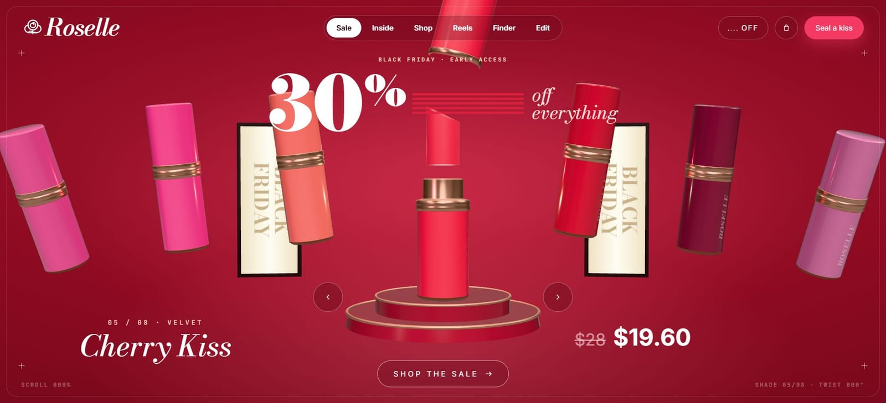 <b>Hero</b>: eight shades on a fan, light boxes, pedestal</td>
    <td width="50%">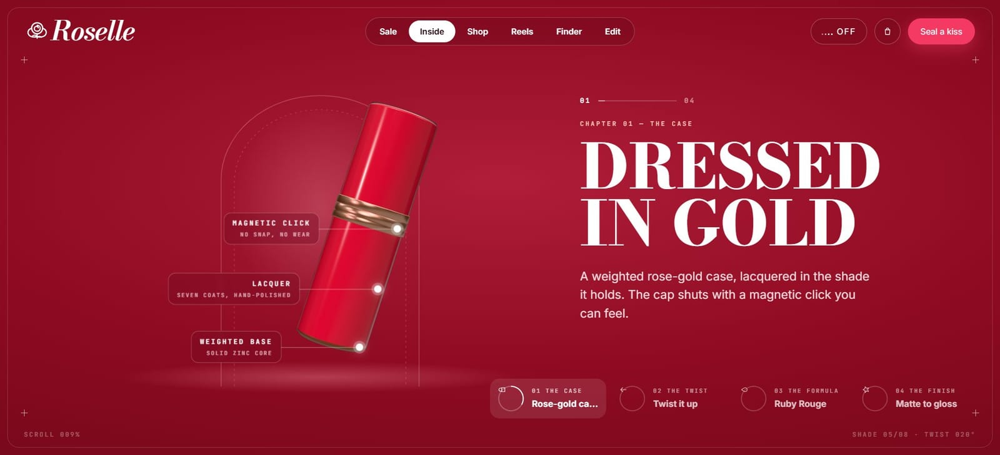 <b>01 · Dressed in gold</b>: labels pinned to the case</td>
  </tr>
  <tr>
    <td>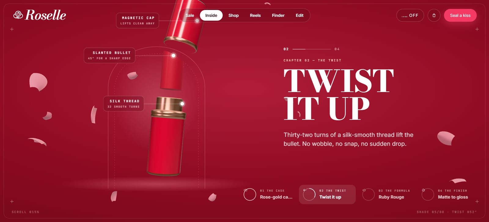 <b>02 · Twist it up</b>: the cap lifts, the bullet rises</td>
    <td>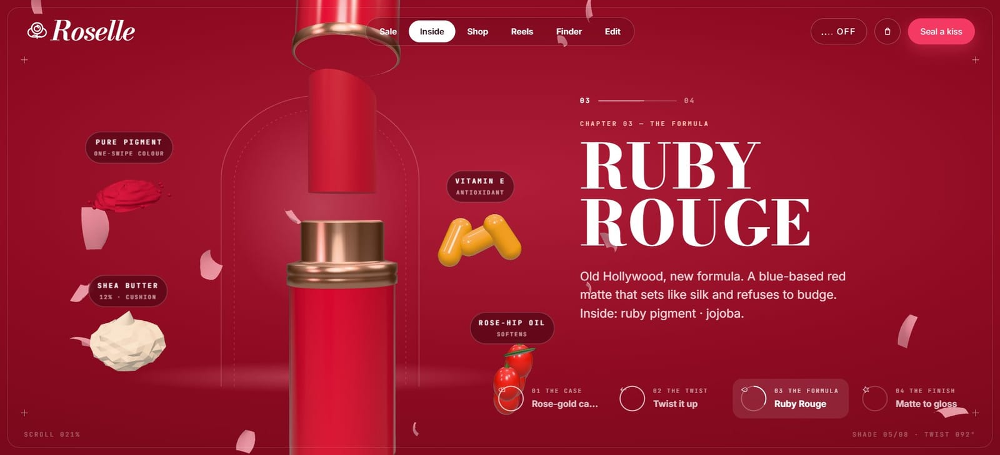 <b>03 · Ruby rouge</b>: pigment, shea, vitamin E, rose hip</td>
  </tr>
  <tr>
    <td>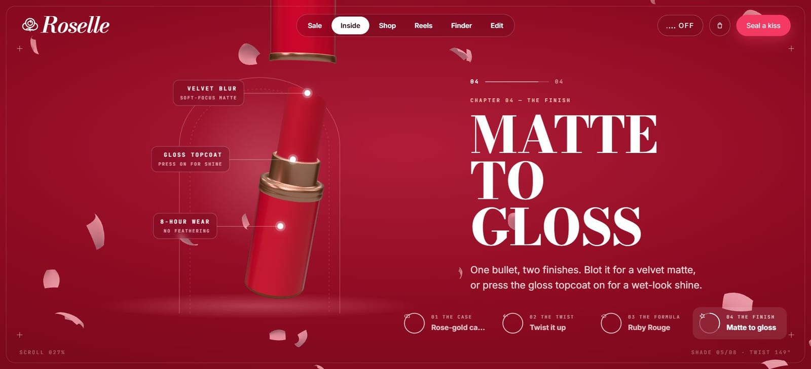 <b>04 · Matte to gloss</b></td>
    <td>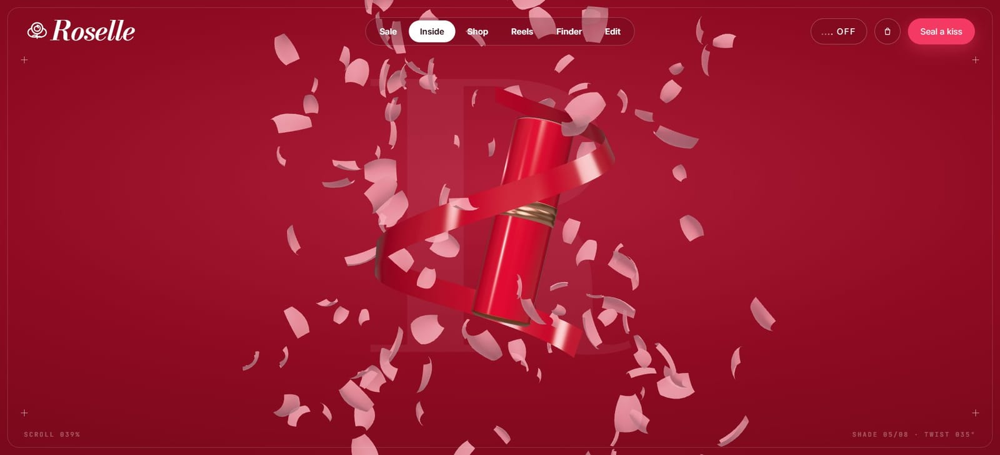 <b>The swirl</b>: a ribbon pours, petals become a tornado</td>
  </tr>
  <tr>
    <td>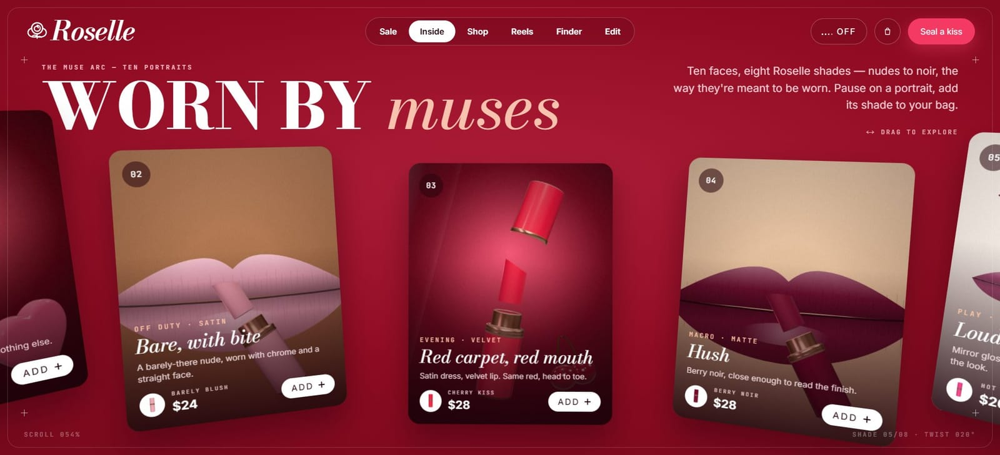 <b>Worn by muses</b>: a draggable arc of ten portraits</td>
    <td>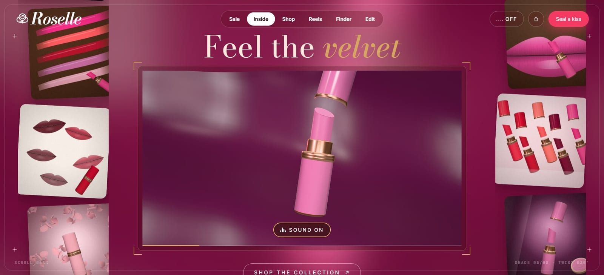 <b>Feel the velvet</b>: a live 3D silk loop, with sound</td>
  </tr>
  <tr>
    <td>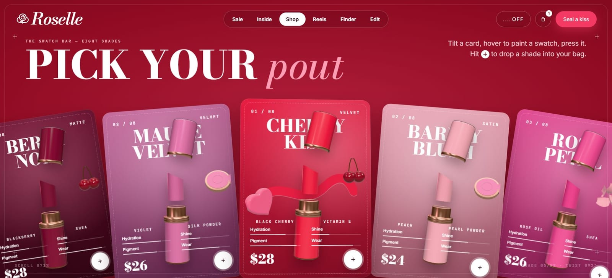 <b>Pick your pout</b>: tilt cards for eight shades</td>
    <td>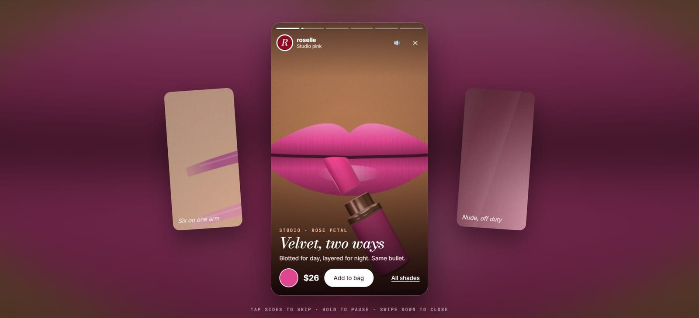 <b>On the lips</b>: the story-style reel viewer</td>
  </tr>
  <tr>
    <td>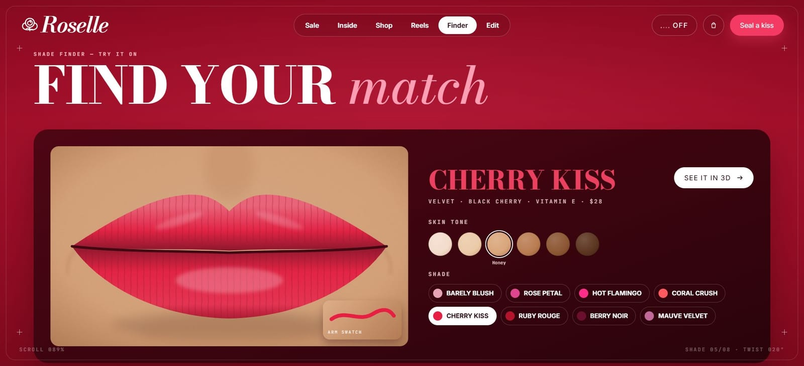 <b>Find your match</b>: an SVG lip try-on, six skin tones</td>
    <td>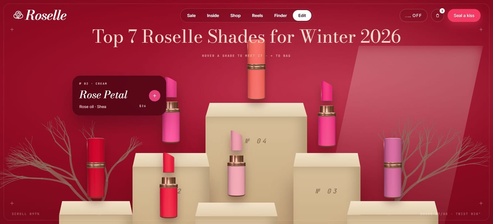 <b>The winter edit</b>: hover a lipstick for its card</td>
  </tr>
</table>

### 📱 On phones (390 px)

<table>
  <tr>
    <td>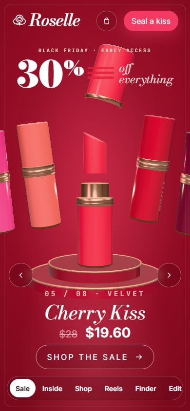</td>
    <td>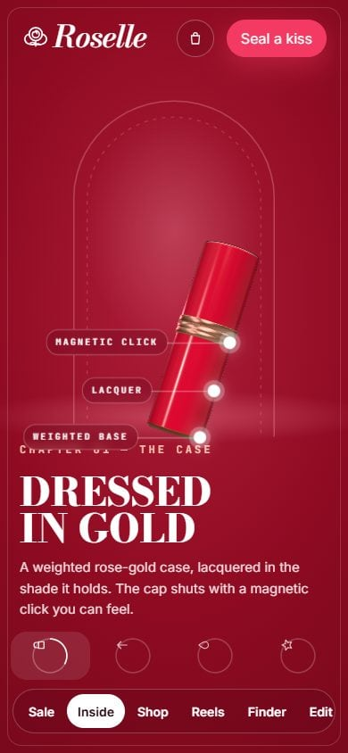</td>
    <td>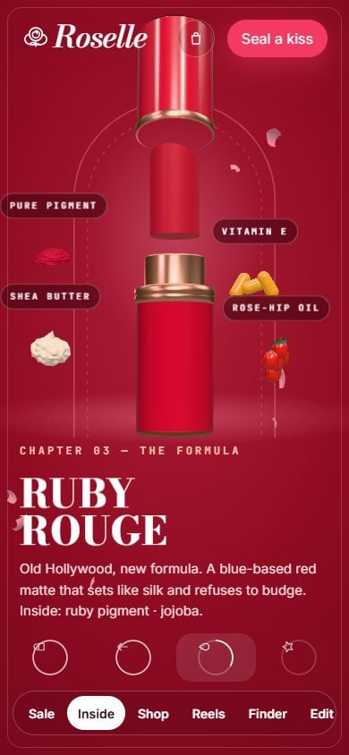</td>
    <td>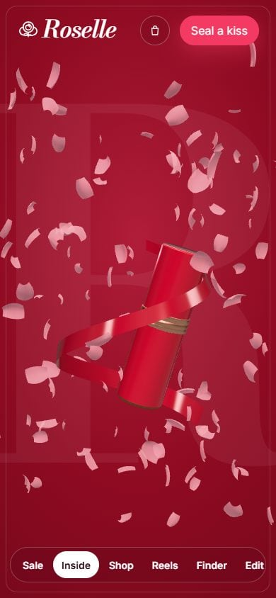</td>
  </tr>
  <tr>
    <td>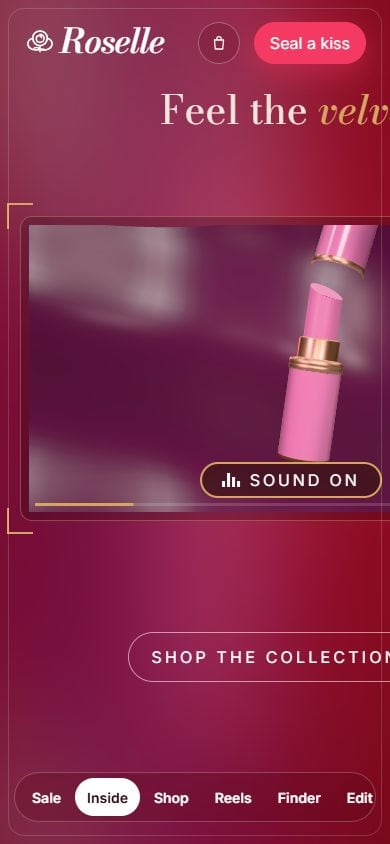</td>
    <td>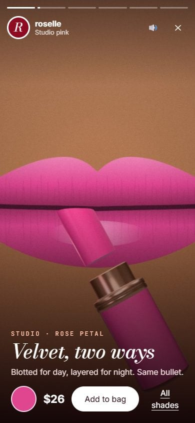</td>
    <td>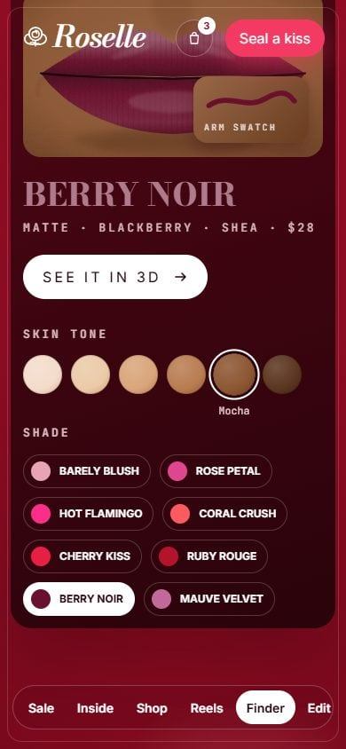</td>
    <td>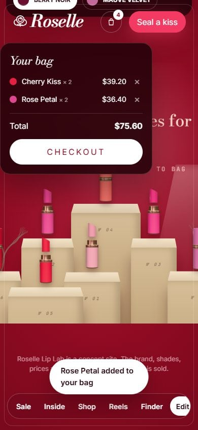</td>
  </tr>
</table>

---

## 🛠️ How it works

- **One WebGL renderer for the whole page.** A single canvas sits behind the HTML. The hero, the Inside stage and the silk film each register as a "view" tied to a DOM element, and each draws into its own scissor rectangle.
- **The lipstick is built in code.** One class makes the lathed case, rose-gold rings, slanted bullet and cap, and two numbers drive it: `open` and `twist`. Anchor points are projected to the screen every frame, so the labels stay pinned while it turns.
- **One scroll value tells the story.** The Inside section blends between five poses as you scroll, then a second value pours the ribbon and spins 150 instanced petals into a tornado.
- **Fast on a laptop GPU.** The first build took 33.6 s to appear. It now takes about 7 s, thanks to:
  - shared shader programs
  - background `compileAsync` warm-ups
  - all 28 product shots rendered into one atlas
  - revealing the page before the background art is done
- **Photos without photos.** The muse cards, reels and film stills are composed on canvases from the rendered products and a lip shape drawn in code.

Full details are in **[HOW-IT-WORKS.md](HOW-IT-WORKS.md)**.

> **Concept site.** Roselle is a fictional brand. The shades, prices and Black Friday sale are made up. The bag, checkout and "Seal a kiss" code are demos, and nothing is sold.
